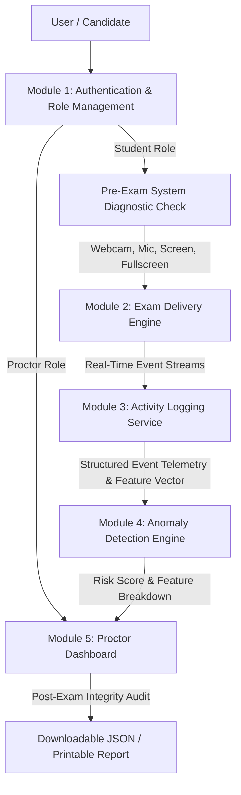

# Online Proctoring System with Behavior Analysis (`SafeExam AI`)

**Institution:** RGM College of Engineering and Technology (Autonomous), Nandyal  
**Department:** Computer Science and Engineering (Data Science)  
**Academic Year:** 2026-2027 | I Semester | Batch 2024-2028  
**Problem Statement:** #3 — Online Proctoring System with Behavior Analysis  

---

## 📌 Executive Summary

Remote online examinations are highly vulnerable to academic malpractice (tab switching, unauthorized aids, impersonation, unpermitted collaboration) that cannot be monitored manually at scale. 

**SafeExam AI** is an intelligent, full-stack client-side proctoring and behavior analytics platform. It orchestrates real-time computer vision (facial landmark tracking), acoustic monitoring (Web Audio API), telemetry tracking (tab switching, window focus, keystrokes, idle time, rapid answering), and a machine learning anomaly detection engine that predicts malpractice likelihood scores and compiles structured integrity audit reports.

---

## 🏗️ System Architecture & Flowchart



---

## 🧩 Core System Modules

### 1. Authentication & Role Management (`src/components/LoginPage.jsx`)
* **Dual Role Separation:** Dedicated portals for **Students** (Full Name + University Registration Number) and **Proctors/Faculty** (Admin credentials).
* **Session Attribution:** All telemetry logs, snapshots, and anomaly scores are strictly linked to candidate credentials.

### 2. Exam Delivery Engine (`src/components/ExamPortal.jsx` & `src/data/questions.js`)
* **Timed Question Delivery:** Configurable countdown timer with dynamic color shifting (normal &rarr; amber &rarr; alert red).
* **Question Bank:** Modular CS question dataset covering Algorithms, OOP, Database Systems, Computer Architecture, and Networks.
* **Flag / Bookmark for Review:** Visual amber tags allowing candidates to mark questions for second-pass review.
* **Progress Tracking:** Live progress bar with completion percentages.
* **Safe Submission Modal:** Confirmation dialog preventing accidental submissions while summarizing answered, flagged, and unanswered questions.

### 3. Activity Logging Service (`src/services/ActivityLogger.js`)
* **Structured Event Schema:** Standardized JSON events with timestamps, severity levels (`LOW`, `MEDIUM`, `HIGH`, `CRITICAL`), and visual base64 canvas snapshots.
* **Monitored Telemetry:**
  - `TAB_SWITCH`: Document visibility change tracking.
  - `FOCUS_LOST`: Window blur event tracking.
  - `IDLE_DETECTED`: Detects inactivity (> 15s without mouse movement or keystrokes).
  - `KEYSTROKE_BURST`: Real-time candidate typing velocity.
  - `RAPID_SUBMISSION`: Flags questions answered in under 5 seconds (rapid guessing).
  - `DEVTOOLS_ATTEMPT` & `COPY_PASTE`: Shortcut suppression (`F12`, `Ctrl+C`, `Ctrl+V`, right-click).
  - `NOISE_DETECTED`: Real-time room acoustic energy monitoring.
  - `GAZE_AWAY` & `FACE_ABSENT` & `MULTIPLE_FACES`: Vision-based identity anomalies.

### 4. Anomaly Detection Engine (`src/services/AnomalyDetector.js`)
* **Mathematical Approach:** Weighted Multi-Feature Scoring Model with normalized baseline vectors:

$$\text{Risk Score} = \min\left(100, \left( \frac{\sum_{i=1}^n w_i \cdot \text{norm}(f_i, b_i)}{\sum_{i=1}^n w_i} \right) \times 100 \right)$$

| Feature ($f_i$) | Weight ($w_i$) | Baseline ($b_i$) | Anomaly Description |
|---|---|---|---|
| `tabSwitchCount` | 0.25 | 5 events | Tab/window switches during active exam |
| `gazeAwayDuration` | 0.20 | 60 sec | Time looking away from monitor |
| `faceAbsentDuration` | 0.20 | 30 sec | Time candidate is absent from camera |
| `totalIdleTime` | 0.10 | 120 sec | Extended inactivity without interaction |
| `rapidSubmissions` | 0.10 | 3 questions | Answers submitted in < 5 seconds |
| `noiseSpikeCount` | 0.05 | 5 spikes | Sustained background noise or speech |
| `avgKeystrokeRate` | 0.05 | 10 key/min | Abnormally low interaction velocity |
| `copyPasteAttempts` | 0.05 | 3 attempts | Clipboard and context menu violations |

* **Classification Thresholds:**
  - **0% – 30% (Low Risk):** `APPROVED` — Standard integrity compliance.
  - **31% – 60% (Medium Risk):** `MANUAL REVIEW RECOMMENDED` — Warning triggers detected.
  - **61% – 100% (High Risk):** `FLAGGED / SUSPENDED` — Critical integrity breach.

### 5. Proctor Dashboard (`src/components/ProctorDashboard.jsx`)
* **Candidate History Audit:** Local persistence (`localStorage`) supporting past session inspection.
* **Synthetic Benchmark Dataset:** Pre-loaded multi-candidate behavioral profiles to validate ML anomaly detection across various cheating patterns.
* **Evidence Snapshot Drawer:** Visual frame capture viewer displaying timestamped candidate webcam evidence.
* **Category Anomaly Chart:** SVG bar chart plotting incident distributions.
* **Answer Key Audit:** Collapsible question-by-question breakdown showing candidate choices vs official answers.
* **Report Generation:** One-click JSON export and printable official integrity reports (`window.print()`).

---

## 📊 Synthetic Benchmark Dataset Profiles (`src/data/syntheticDataset.js`)

1. **Rahul Sharma (`24091A3201`):** Normal Candidate &rarr; Score: 90/100, Risk: 8% (**Approved**)
2. **Priya Patel (`24091A3202`):** Tab Switcher & Gaze Anomaly &rarr; Score: 80/100, Risk: 72% (**Flagged**)
3. **Karthik Varma (`24091A3204`):** Multi-Face Impersonation & DevTools &rarr; Score: 30/100, Risk: 94% (**Suspended**)
4. **Ananya Reddy (`24091A3203`):** High Idle & Rapid Guessing &rarr; Score: 60/100, Risk: 52% (**Review Required**)
5. **Sneha Rao (`24091A3206`):** Benchmark Clean Session &rarr; Score: 100/100, Risk: 5% (**Approved**)

---

## 🚀 Installation & Running Guide

### 1. Prerequisites
* **Node.js** (v18.0.0 or higher) - [Download Node.js](https://nodejs.org/)

### 2. Setup & Run
```bash
# Clone or navigate to the project root
cd online-proctoring-system

# Install dependencies
npm install

# Start development server
npm run dev
```
Open **`http://localhost:5173/`** in your browser.

### 3. Default Login Credentials
* **Student Login:** Enter any Name and University Registration Number (e.g. `24091A3202`).
* **Proctor Login:**
  - Username: `admin`
  - Password: `admin123`

---

## 💡 Placement & Viva Technical Discussion Points

1. **How is gaze deviation computed?**  
   We calculate the horizontal Euclidean distance ratio between the nose tip (facial landmark point 30) and the left/right jaw contours (points 0 & 16) using `face-api.js` TinyFaceDetector + 68-point landmark network. Ratios $< 0.45$ or $> 2.2$ sustained over 3 consecutive debounced frames trigger a gaze deviation violation.
2. **How are false positives eliminated?**  
   We use consecutive-frame smoothing counters (e.g. 3 frames for gaze/face absence) and a 3000ms cooldown window per anomaly type to prevent transient head shifts or micro-glances from creating false alerts.
3. **How does the ML anomaly scoring compare to standard classification?**  
   Our Anomaly Detection Engine operates as a weighted linear multi-factor scoring model. In an enterprise production deployment, the feature weights ($w_i$) can be fitted via Logistic Regression or Random Forest classifiers trained on historical proctoring datasets.

---

**SafeExam AI** — Built for Department of CSE(DS), RGM College of Engineering and Technology.
